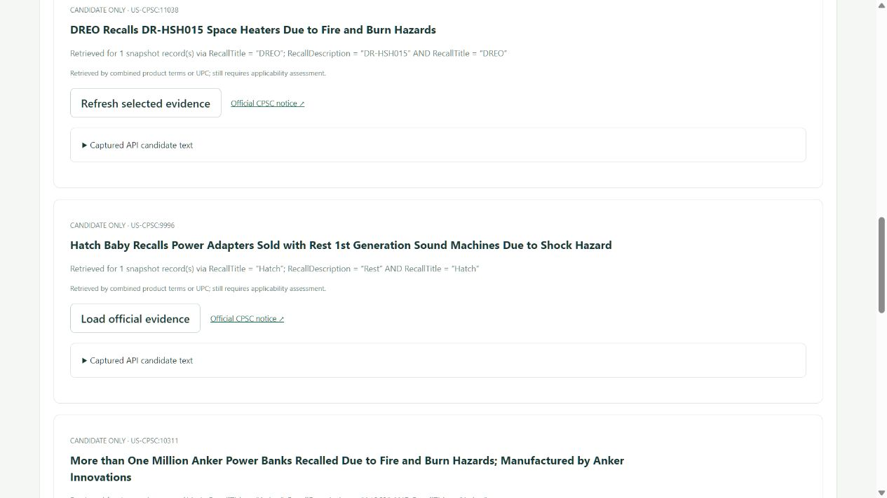

# Recall-to-Inventory Bridge

Connect US CPSC recall evidence to the inventory systems a retailer already uses.
Import CSV/JSON stock snapshots, discover candidate notices, investigate selected
evidence with native IRIS AI Hub, and return versioned **advisories**. The existing
ERP/WMS/POS and its operators own stock, sale and shipment actions.

[First visit](docs/first-visit.md) · [日本語](docs/first-visit.ja.md) ·
[Integration contract](docs/inventory-integration.ja.md) · [OpenAPI](schemas/openapi.json)

[Watch the 98-second operation demo](https://www.youtube.com/watch?v=kQNJ_kUx9tA):
real CPSC retrieval, synthetic inventory and a separately labelled saved native AI run.

## Workflow

1. Preview a CSV/JSON export from an existing system. Inspect column mappings and
   row errors, then import a separate inventory snapshot. Leading-zero IDs, source
   references, lot/warehouse identity and reported quantities are preserved.
2. Review the exact public product terms to send to CPSC. The Interoperability
   Production retrieves candidate notices without a model key. A candidate is
   not a confirmed match; a zero-result search never proves product safety.
3. Select notices to acquire official evidence. Native `%AI.Agent` investigates
   associated records with one scoped read tool when inference is explicitly enabled.
4. Read versioned JSON/CSV advisories containing citations, missing fields, source
   versions and run provenance. The example receiver creates a local review worklist.
5. Optionally enable recurring recall audits. The custom IRIS adapter repeats
   searches and refreshes selected sources. New candidates require review;
   automatic AI is a separate opt-in, capped at one investigation per cycle.



## Quick start without an API key

Requirements: Docker with Linux containers, Python, and an authorized private
**IRIS Community AI Hub 2027.1.0AI.109.0** image from the
[InterSystems EAP portal](https://evaluation.intersystems.com/Eval/early-access/AIHub).
Do not publish EAP archives or base/derived Docker images.

```bash
docker image load -i /path/to/iris-community-2027.1.0AI.109.0-docker.tar.gz
docker image ls
docker tag <loaded-image-name> recall-guard-aihub:2027.1.0AI.109.0
python scripts/init_env.py
python scripts/judge_demo.py start --iris-build 109 --build
```

Open [the local app](http://localhost:52773/recall-guard/auth/RecallGuard.Home.cls).
Sign in with `SuperUser` and the generated `IRIS_PASSWORD` in the ignored local
`.env`. The helper starts a separate no-key instance with inference disabled.
It retains its own data and does not reset an existing dataset.

Choose **Load sample export → Preview import → Import previewed snapshot →
Review search terms → Search CPSC with these terms**. Select an official notice,
load its evidence, then download advisory JSON/CSV. Follow the
[first-visit guide](docs/first-visit.md) for screenshots, limits and the separate
optional recorded AI course.

```bash
python scripts/judge_demo.py stop --iris-build 109
```

The package is also available from the public IPM registry. In a prepared,
dedicated `RECALLGUARD` namespace with the community registry enabled, run
`zpm "install recall-to-inventory-bridge"`. Follow [IPM installation](docs/ipm.md)
for namespace preparation, registry setup and explicit Production startup.

## Evidence and authority

One IRIS instance contains an actual Interoperability Production, native AI Hub,
Embedded Python, SQL persistence, authenticated REST and a browser UI. There is
no additional database, queue service or LLM framework. Native messages carry
source retrieval, context access, investigation and validation.

The agent has no external action tools. Validation checks exact source quotes,
identifiers, manufacturing ranges, component/generation scope and source/inventory
versions. Unsupported claims become review advice. Confidence does not grant clearance.

The bridge has no external inventory writeback connector. Imported snapshots
cannot call the optional local synthetic sale/shipment simulator. The receiving
system owns real-world action authority.

The [trace guide](docs/traceability.md) implements
[Community Opportunity DPI-I-689](https://ideas.intersystems.com/ideas/DPI-I-689):
native messages correlate run IDs, prompt/policy versions, tool context hashes and
provider-returned usage. Per-provider HTTP spans and SDK-internal retries are
outside the instrumentation. [Verification](docs/verification.md) distinguishes
portable tests, recorded validation and genuine native investigations.

## Live inference and recurring audits

Live inference is opt-in through `GEMINI_API_KEY`, `FREE_TIER_CONFIRMED=true` and
`AGENT_MODE=live`. Verify your provider's Free Tier/no-billing configuration first.
There is no paid fallback. The default cap is five investigations per UTC day;
SDK/provider request counts can be higher. Never commit credentials.

The [audit contract](docs/recurring-audit.md) describes intervals, source changes,
assessment reuse and incomplete coverage. Monitoring requires a running IRIS host
and Production. It does not fetch inventory from an ERP or change external stock.

## Limits and license

This evaluation supports 100 inventory records, a 100,000-byte input, eight
queries per search, 40 candidates and 40 selected notices. It is not a complete
CPSC index or a general safety clearance. FDA and other national feeds, enterprise
catalogue synchronization and vendor-specific ERP connectors are outside this version.

Original code is **MPL 2.0**. CPSC material and InterSystems software retain their
own terms. Internal `RecallGuard` identifiers preserve technical compatibility.

[Architecture](docs/architecture.md) · [Build compatibility](docs/build-compatibility.md) ·
[Release notes](docs/releases/0.1.0.md) · [Source license](LICENSE)
