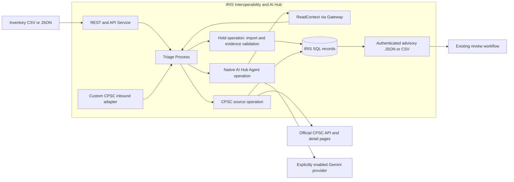

# Architecture and decision boundaries

Recall-to-Inventory Bridge connects existing ERP/WMS/POS data to US CPSC evidence.
It imports a local inventory snapshot, retrieves candidate notices, investigates
selected evidence and returns versioned advice. The receiving system and its
operators retain authority over stock, sales and shipments.

## Message routing and native agent

The [Production](../src/RecallGuard/Production.cls) routes API requests through
the [Triage process](../src/RecallGuard/Process/Triage.cls). Snapshot previews and
imports execute synchronously in Hold. Candidate discovery and selected-source
retrieval execute asynchronously in CPSC. HTTP 202 confirms acceptance;
`source_task` and `request_id` identify the stored result or failure.

The [investigator](../src/RecallGuard/Agent/Investigator.cls) is a native `%AI.Agent`
subclass. It interprets product scope and returns structured proposals. Its one
scoped read-only tool receives the full selected source snapshots and relevant
product attributes. It has no external action tool. The native Gateway routes
context access and validation through Hold, keeping Embedded Python out of the
agent worker. Model and source network waits occur outside database transactions.

Interoperability messages correlate run IDs, audit-cycle IDs, input versions,
context hashes, prompt/policy versions and provider-returned usage. The
[DPI-I-689 trace guide](traceability.md) shows actual saved sessions and explains
how to inspect a new installation's own run IDs. SDK-internal provider turns,
retries and HTTP spans are outside this instrumentation.

## Inventory and source boundaries

[Inventory import](../python/recall_guard/inventory.py) validates UTF-8 CSV/JSON,
column aliases or explicit mappings, input sizes, types and identifiers. Preview
does not write records. `preview_hash` and `workspace_revision` reject changed
inputs or stale previews; `source_system` and `import_id` make captures idempotent.
Source timestamps reject out-of-order updates and conflicting equal timestamps.

SKU and external IDs remain strings. Without an external ID, SKU, lot and location
form the record identity. Quantity is a reported source value; it is excluded
from the AI identity version. Changes to model, manufacture date, component,
generation or data classification invalidate prior assessments. Absent rows are
not implicitly deleted. No connector writes these snapshots back to an ERP.

[Discovery](../python/recall_guard/discovery.py) sends only reviewed product terms
through supported CPSC parameters. It omits business IDs, warehouse, quantity and
serial from queries. A repeated request ID reuses its stored discovery. Partial
queries, limits and failures remain visible; zero results never establish safety.
Candidates do not become assessments merely because a search returned them.

Selecting a candidate fetches its official evidence and checks that inventory
identity versions have not changed before activating the notice. The scoped AI
context omits SKU, external ID, warehouse and quantity, while retaining opaque lot
IDs, versions and relevant product attributes. Expected labels are never supplied
to the agent. Source and inventory text cannot grant new tool authority.

## Evidence validation and advice

Hold checks proposals for exact quotes, source and inventory versions, supported
operators, identifiers, inclusive manufacturing ranges, component identity,
generations, qualifiers and contradictions. Confidence alone grants no clearance.
Missing identifiers, unsupported claims or invalid quotes require review. A narrow
input decoder normalizes only unambiguous two-month strings and records the
original proposal alongside the conversion.

Internal `HOLD_RECALL` and related identifiers preserve technical compatibility.
The external feed uses `RECALL_MATCH`, `REVIEW_REQUIRED`, `NOT_EVALUATED`,
`NO_MATCH_IN_SELECTED_NOTICES` and `CANDIDATES_FOUND`. Every feed states
`ADVISORY_ONLY`, `external_inventory_updated=false` and its limited notice scope.
Saved feeds remain readable when the Production is stopped.

Operator review stores the authenticated reviewer and source/inventory/run
versions. Stale or duplicate reviews are rejected. Review changes a local
assessment, not source inventory, and cannot release a confirmed recall match.

## Recurring audits

The [custom inbound adapter](../src/RecallGuard/Adapter/CPSCInbound.cls) checks
local due state every 60 seconds and queues an audit only when explicitly enabled.
Monitoring defaults to off. The service uses `%WaitForNextCallInterval`, and queue
reservation is atomic. Snapshot workspaces use their reviewed inventory search
plan and refuse the older fixed-ID demonstration refresh path.

[Monitoring](../python/recall_guard/monitor.py) searches candidates, refreshes up
to five selected notices per cycle and records source changes, omissions and
failures. Source changes invalidate old assessments; incomplete audits also reach
the receiving worklist. The latest ten cycles are retained. Actual timing can
add up to about a minute to the selected interval.

Automatic AI is a separate opt-in, limited to one investigation per cycle and
the existing daily cap. The worker rechecks policy generation, input versions and
duplicates. Current assessments are reused, and unchanged failed inputs are not
repeatedly investigated. See the [audit contract](recurring-audit.md).

## Separate recorded course and synthetic consumer

The optional recorded course verifies a pinned original v6 context and proposals,
then revalidates them with the evidence policy. It preserves original prompt
versions and provider usage as provenance. New validation records have
`mode=recorded-demo`, empty tool calls and no new inference usage; they are not
fresh v7 AI investigations.

Sale/Ship is available only to the separate local synthetic consumer simulator.
It uses a pool size of one, atomic SQL, idempotent requests and mixed-order refusal.
Imported snapshots cannot use that API, even if classified as synthetic examples.
The browser retains an unconfirmed receipt in session storage for safe retry.
Snapshot and recorded courses cannot be mixed or reset to replenish quantities.

## Persistence, inference limits and extension seams

IRIS persists typed JSON records for notices, lots, runs, assessments,
transactions, reviews, events, metadata, inventory imports and discoveries.
Evidence retains original content, URLs, retrieval times and hashes.

The default inference cap is five investigations per UTC day, with at most four
agent rounds. Gemini use requires the installer's Free Tier/no-billing confirmation;
there is no paid fallback. Provider request counts can exceed investigation counts.
Failures, expired runs and missing evidence never count as a completed assessment.

The evaluation supports 100 inventory records, eight queries per search, 40
candidates and 40 selected notices. It supplies neither a complete CPSC index nor
general safety clearance. Regulator normalization, snapshot import and the
advisory feed form extension seams for other sources and receiving adapters.
Only US CPSC is implemented; FDA, other national feeds and vendor-specific ERP
connectors are outside this version. Native Workflow Engine, Java/.NET PEX and
Vector Search are not part of the current Production.