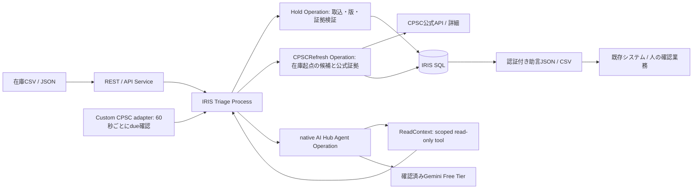

# Recall-to-Inventory Bridgeの実装構成

2026-11-05更新。主用途は既存ERP/WMS/POSとのread-onlyな情報連携。
在庫snapshotを取り込み、在庫起点のCPSC候補検索、選択告知のAI評価、根拠付き助言を渡す。
販売停止、出荷、実在庫数量の変更を行う権限・接続先・書込toolは持たない。

## Productionの役割

API ServiceからTriageへ要求を流し、snapshotのpreview/importはHoldで同期処理する。
候補検索・選択証拠の取得はCPSCRefreshで非同期に行う。HTTP 202は受付で、source_task/request_idで結果を追う。
取得時にネットワークをDB lockの中へ入れない。開始・完了・失敗とquery結果を保存する。
agentのworkerからEmbedded Pythonを呼ばず、native GatewayからHoldへcontextとvalidationを渡す。
これは初期のworker混在を回避して実際のAI Hub調査が完了した構成を維持している。

独自CPSC inbound adapterは60秒ごとにローカルの監査dueを確認し、有効なときだけaudit_tickをqueueへ送る。
監査は既定offで、従来のcurated demo refreshのPollEnabledも既定disabled。
snapshot workspaceではcurated 3 IDへのrefreshを拒否し、ユーザーが確認した在庫検索planを使用する。
Retailer Operationは任意のlocal synthetic downstream simulator用。snapshot workspaceではサーバー側で拒否する。
標準Workflow Engine、PEXやVector Searchは追加していない。

monitor.pyは在庫検索・選択告知最大5件の再取得・差分履歴を管理する。queue予約をatomicにし、
serviceは%WaitForNextCallIntervalを設定して同じdueの大量投入を防ぐ。
AIは別のopt-inで、1周期1調査・既存日次cap以内。worker側でもpolicy世代、入力版、重複を再確認する。
原文更新は旧評価を古くし、不完全な監査はaudit_attentionとして確認worklistへ渡す。
履歴は最新10周期。時刻はadapterの確認境界に依存し、設定間隔に最大約1分の追加待ちがある。
詳しくは[監査の契約](recurring-audit.md)を参照。

## Snapshotの境界

inventory.pyはUTF-8 CSV/JSON、列aliasと明示的mapping、入力サイズ・型・識別子を検証する。
previewは書き込まず、全行が有効な入力だけ取り込める。preview_hashとworkspace_revisionにより、
入力差替えやpreview後の競合を検出する。source_system/import_idの内容hashで再送を冪等にする。
元システムの更新日時があれば逆順到着と同じ日時の矛盾を拒否する。

保存するのはローカルのsnapshotと取込履歴。SKU/外部IDは文字列。外部IDがない場合はSKU・lot・locationを複合識別する。
数量は元システムの報告値としてのみ更新し、AI評価のidentity versionには含めない。
製造月・型番・部品・世代などが変わると評価を古くする。データ分類の変更もidentity versionを変える。
未掲載レコードは削除しない。元システムへ戻す更新・注文・販売停止のコードはない。

## 候補検索とAI評価を分ける

CPSCの正式parameterだけで、表示した商品語句を検索する。SKU・外部ID・倉庫・数量・serialはqueryに含めない。
request_idによる再送は同じ検索結果を返し、無制限に取り直さない。
検索は部分一致で、無関係な候補があり得る。0件やquery失敗を安全性の根拠にしない。
検索候補の時点ではassessmentを作らない。

候補を選ぶと公式詳細を再取得し、検索時の在庫版がまだ有効な場合だけ評価対象にする。
live AIはoperatorが明示した場合だけ呼ぶ。最新promptはinvestigator-v7-advisoryで、
外部操作の権限を持たないと明記する。関連在庫を最大20件ずつ処理し、完了済みの現在版を無駄に再推論しない。

ReadContextは完全な公式snapshotと必要な商品属性を渡す。snapshotコースでは業務上のSKU/外部ID/倉庫/数量を除き、
opaque lot_id、identity version、ブランド・型番・製造月・部品・世代・UPC等だけを渡す。
期待ラベルはagentに渡さない。sourceやinventoryの文字列を権限変更の指示として扱わない。

## 証拠検証と助言

native %AI.Agentが返すMATCH_RECALL / NO_MATCH_FOR_NOTICE / INSUFFICIENT_EVIDENCEをHoldで検証する。
引用の実在、snapshot/lot版、条件演算子、型番、製造月範囲、対象部品、世代、qualifierと矛盾を検査する。
confidenceだけで許可を出さない。policyはevidence-v2のまま。無効な引用は確認送りにする。
限定したinput decoderは曖昧さのない2か月の文字列表現だけを配列化し、元提案と変換を記録する。

内部のHOLD_RECALL等は後方互換の評価コード。外部への助言はRECALL_MATCH、REVIEW_REQUIRED、
NOT_EVALUATED、NO_MATCH_IN_SELECTED_NOTICES、未評価でも候補がある場合はCANDIDATES_FOUND。
いずれもADVISORY_ONLYで、販売停止命令・在庫変更・出荷許可ではない。
read feedはProduction停止中でも保存済み情報から取得できる。

operator reviewは認証済みユーザーと原文/在庫/run版を保存し、古い内容や二重確認を拒否する。
変更するのはローカルassessmentだけで、元在庫は変更しない。確認済み回収対象をこのreviewだけで解除しない。

## 歴史的な実AIデモとsimulator

固定packageのgenuine v6提案と当時のCPSC/模擬在庫を、その場の証拠policyで再検証する別courseを残す。
元prompt版は推論の来歴なのでv6を保ち、最新live prompt v7と混同しない。
package hash、元ReadContext hash、原文/在庫版を照合し、元runとusageをrecorded_originに保存する。
新規runはmode=recorded-demo、tool_calls空、usageなし。新しい推論やAI traceを捏造しない。

このcourseのSale/Shipは模擬consumer。pool size 1、atomic SQL、idempotencyと混合注文拒否を持つ。
実在庫snapshotはこのAPIへ渡せず、仮にsynthetic-exampleと分類してもサーバーで拒否する。
ブラウザーはsimulatorの未確認receiptをsessionStorageに保ち、再送で二重消費しない。
既存snapshotと記録済みデモを混在させず、resetや数量補充によるやり直しを行わない。

## 費用、保存と拡張

Geminiを使う場合は、Free Tier・請求先未連携であることを利用者が確認する。有料fallbackなし。
既定5 investigations/UTC日、agent loop 4まで。失敗・期限切れや不足証拠を確認済みとして扱わない。
新しいpromptのlive検証と、保存済みv6の再検証の結果は別々に記録する。

IRISの種類別JSONにnotice、lot、run、assessment、transaction、review、event、metaに加え
inventory_import、discoveryを保存する。モデル待ちとCPSC通信は共通mutex/DB transactionの外で行う。
API/詳細の原文、出典URL、取得時刻、hashを保持し、nativeメッセージとrun IDで業務処理へ追跡する。

評価版は100レコード、8queries/検索、40候補・選択告知40件まで。全CPSC索引・大規模同期・全件coverageではない。
regulator正規化、snapshot取込、助言feedを境界にして、将来の別当局や受信側adapterを追加できる。
今回の実装対象はUS-CPSC。FDA、他国、製品固有ERP connectorは含めない。
