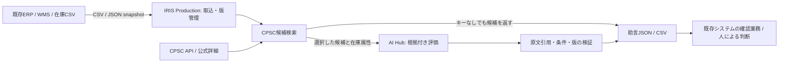

# 既存の在庫システムとの連携

Recall-to-Inventory Bridgeは、既存のERP/WMS/POSが出す在庫データを受け取り、CPSCの候補検索と
証拠に基づく助言を返す。既存システムの販売停止・出荷・在庫変更を実行する権限や接続情報は持たない。
返された結果をどう扱うかは、既存システムと担当者が決める。



## 入力と取り込み

CSVはUTF-8（BOM可）で、区切りはcomma、semicolon、tab。JSONはobject array、`items`配列を持つobject、
またはREST requestのnative `items`を受け付ける。[項目schema](../schemas/inventory-item.schema.json)を参照。
必須は`sku`、`name`、`quantity`。`external_id`がなければSKU・ロット番号・倉庫の組み合わせで識別する。
同じSKUに複数の製造ロットがある場合は、`external_id`または`lot_number`を必ず区別する。

SKU、型番、UPC、外部IDは文字列で扱い、先頭ゼロを保持する。quantityは0以上の整数。
メーカー、ブランド、型番、製造月、部品型番、世代、倉庫、ロット番号、UPC、元システムの更新日時を受け付ける。
製造月は`YYYY-MM`、不明なら空欄。source_updated_atを付ける場合はtimezone付きISO日時を使う。
シリアル番号や顧客情報を検索に送る設計ではない。

既知の別名（`item_code`、`product_name`、`on_hand`など）を検出し、独自の列名にはmapping JSONを指定できる。
意味が曖昧な列を勝手に選ばず、複数候補があると明示的なmappingを要求する。
未使用列、認識したmapping、行単位のエラーと先頭5行を取込前に表示する。不正な行がある場合は全体を取り込まない。

- [標準CSV例](../examples/inventory/warehouse.csv)
- [独自列名のCSV](../examples/inventory/mapped-warehouse.csv)と[mapping](../examples/inventory/column-map.json)
- [JSON例](../examples/inventory/stock.json)

これらの例はすべて模擬データ。取り込み時に`data_classification=synthetic-example`と明記する。
模擬ファイルを取り込んだ場合も、snapshotコースでは販売・出荷シミュレーターを使用できない。

## 機械連携の契約

同じデータを2段階で送る。認証は既存のIRIS password認証で、UIも同じAPIを使用する。
アプリのbase URLは`/recall-guard`。APIの[OpenAPI定義](../schemas/openapi.json)も用意する。

1. `POST /api/preview_inventory`へ`source_system`とCSV/JSONを送る。
2. `valid=true`の応答に含まれる`preview_hash`と`workspace_revision`、元と同じデータ、安定した`import_id`を
   `POST /api/import_inventory`へ送る。

同一source_system/import_id・同一内容の再送は保存済み結果を返し、二重取り込みしない。
同じimport_idで違う内容を送る、preview後に別の取り込みが進む、古いsource_updated_atを送る、
同じ更新日時で内容が食い違う場合はHTTP 409で拒否する。新しいデータには新しいimport_idを使う。
入力不正はHTTP 400、preview内の行エラーはHTTP 200の`valid=false`で知らせる。

更新はローカルsnapshotへのupsert。既存システムの数量を変更する処理ではない。
数量だけの更新は商品同一性の評価を無効にしない。型番・製造月などの変更は過去評価を古くする。
未掲載のレコードを自動削除・ゼロ在庫扱いにしない。source_updated_atがないファイルは、
明示的に取り込まれた最新captureを採用する。日時を付けると古いcaptureの逆順到着も検出できる。

CLIの例（109、ローカルの`.env`にあるIRIS資格情報を使用。モデルキー不要）：

```bash
python scripts/bridge_sync.py import --file examples/inventory/warehouse.csv --source-system sample-erp --import-id export-20261104-001 --example
python scripts/bridge_sync.py export --format json --output .artifacts/advisories-001.json
python examples/review_consumer.py --advisories .artifacts/advisories-001.json --output .artifacts/review-worklist-001.json
```

最後のサンプルは、受信側で確認タスクを作るだけ。ERPへの書込実装ではない。
ファイル出力は既存ファイルを上書きしない。取込再送には同じimport-idを使い、exportには新しい出力名を使う。

## 在庫からリコール候補を探す

`POST /api/discovery_plan`で、CPSCへ送る検索項目と値を確認する。
`plan_hash`と一意の`request_id`を`POST /api/discover`へ渡すと、IRISのCPSC operationが非同期検索する。
HTTP 202は受付であり完了ではない。`GET /api/state`の`meta.source_task`とrequest_idを照合して完了・失敗を確認する。
`discoveries`に最新の取得結果・検索URL・原文hash・候補と在庫との関連を保持する。

検索には公式APIの`RecallTitle`、`RecallDescription`、`Manufacturer`、`ProductName`、`UPC`だけを使う。
ブランドをtitle、型番をdescriptionなどで探し、SKU・外部ID・倉庫・数量・シリアル番号は検索queryに含めない。
送信前に、実際に送られる商品語句を確認できる。APIは部分一致検索なので、ブランドに似た単語も候補に出る。
候補は`CANDIDATE_ONLY`であり、取得だけで回収対象と確定しない。

候補から1～5告知を選び、`POST /api/select_candidates`へdiscovery_id・notice_ids・request_idを送る。
公式詳細を再取得し、元の在庫版に結び付けて評価対象にする。途中で在庫同一性が変わった場合は選択を拒否する。
新候補を選んだだけではAIを呼び出さない。手動の`investigate`、または別途明示した監査のauto_aiだけが新しい推論を行う。
AIは関連候補の在庫を最大20件ずつ読み、原文に基づく助言を返す。外部在庫の書込toolは持たない。

## 結果を既存システムへ戻す

`GET /api/advisories/json`または`GET /api/advisories/csv`を受信側から取得する。
JSONのschemaは`recall-to-inventory-bridge.advisories.v1`、authorityは常に`ADVISORY_ONLY`。
source_system、external_id、SKU、在庫版、告知URL・版、元のrun ID、引用と不足項目を渡せる。
CSVは1行が1在庫・1選択告知。spreadsheetで数式として実行される文字列は先頭にapostropheを付け、
元の識別子が厳密に必要な機械連携にはJSONを使う。

| 助言コード | 受信側で想定する用途 |
| --- | --- |
| CANDIDATES_FOUND | AIキーなしでも、該当しそうな告知を担当者の確認queueへ渡す |
| RECALL_MATCH | 根拠を既存のリコール対応業務へ渡す。販売停止等は受信側が判断する |
| REVIEW_REQUIRED | 部品・製造月・シリアル照合などの不足情報を担当者に確認する |
| NOT_EVALUATED | 未評価・古い版。許可や安全確認として使わない |
| NO_MATCH_IN_SELECTED_NOTICES | 選択した告知についての除外。商品の一般的な安全性や全リコール除外ではない |

APIは販売停止命令や出荷許可を出さず、webhookで外部システムを書き換える処理もない。
従来のsale/ship APIは別の明示的なsynthetic retailer simulator用で、snapshot workspaceからはサーバーで拒否する。

## 定期監査と受信側の注意

`POST /api/audit_configure`でenabled、auto_ai、interval_secondsを設定する。既定はoff。
有効化には確認済みdiscovery_planのplan_hashが必要。`POST /api/audit_now`はrequest_id付きの手動監査。
既存のcustom adapterがdueを確認し、Production経由で在庫検索と選択原文最大5件の再取得を実行する。
新しい在庫captureは有効な監査を再びdueにする。元ERPからの自動captureやwritebackは行わない。
自動AIは別のopt-inで、1周期1回・既存cap以内。現在版の評価を再利用する。

JSONはmonitor履歴を含み、各item/CSVにaudit_attentionとaudit_cycle_idを付ける。
過去に選択告知の除外評価があっても、不完全な監査のattentionを無視しない。
受信例はそれを確認taskとして残す。監査の失敗・未評価は販売許可ではない。
最新10周期と差分を保持し、単一leaseと重複投入防止を使う。間隔はminute pollingのため概算。
[監査の詳細契約](recurring-audit.md)と[実機証拠](../research/evidence/iris-recurring-audit.json)を参照。

## 検証範囲と評価版の上限

100レコード、入力100,000 UTF-8 bytes、1検索8queries・40候補、選択告知40件を上限にする。
大規模な全件同期、CPSC全件索引、更新watermark、ERP製品固有connectorの完成を意味しない。
検索失敗・上限による省略・0件の結果を残し、`complete_recall_coverage`は常にfalseとする。
検証は模擬のERP exportを使う。実在庫や顧客情報を公開物やコンテストのデモへ含めない。

公式資料：[CPSC API](https://www.cpsc.gov/Recalls/CPSC-Recalls-Application-Program-Interface-API-Information)、
[検索parameterの公式guide](https://www.cpsc.gov/s3fs-public/RecallRetrievalWebServicesProgrammersGuide20180917.pdf)。
