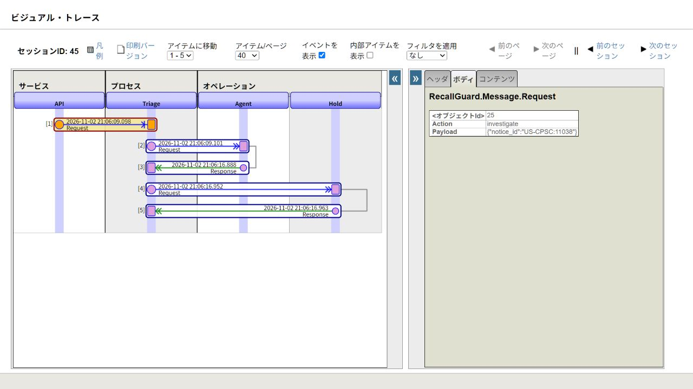

# Trace an AI decision through the IRIS Production

Recall-to-Inventory Bridge addresses [Community Opportunity DPI-I-689](https://ideas.intersystems.com/ideas/DPI-I-689)
by using native Interoperability messages to trace a recall investigation, its
context access and the validation that produces versioned advisories. No external
observability service is required for this application.



## Current advisory example on 109

The [scheduled v7 native trace](../research/evidence/iris-recurring-audit-trace.json)
adds run `6e9d0b1500614c66b0dd5da25e41f7f9`: 15 native messages across sessions
64, 209 and 213, with the same `audit_cycle_id` persisted on the run. It completed
one associated synthetic DREO record and made one ReadContext call. The following
unchanged audit reused the assessment without another inference. The
[actual timer check](../research/evidence/iris-recurring-audit.json) and subsequent
[queue-throttle check](../research/evidence/iris-audit-throttle.json) have distinct scopes.
An earlier queue-delivery bug pushed its headers beyond the default recent 2,000
window; a bounded 10,000-header scan recovered them. No trace was fabricated.
The bug was corrected in application code; no vendor-bug bonus is claimed.

The [genuine v7 trace](../research/evidence/iris-advisory-v7-trace.json) is from
run `734900d502544860ad9c608fec8c7ed1`, executed on November 4 UTC for one
imported synthetic DREO record. Native sessions 55, 57 and 61 cover the agent,
run preparation and scoped ReadContext. Model `gemini-3.5-flash-lite` returned
2,589 input and 464 output tokens (3,053 total). The run completed between
09:22:04.370 and 09:22:10.362 UTC with prompt `investigator-v7-advisory` and
policy `evidence-v2`.

The [advisory check](../research/evidence/iris-advisory-v7-native.json) confirmed
the ReadContext hash, omission of business IDs/quantity from its product context,
validated MATCH_RECALL and unchanged reported quantities. Inspecting the
[saved audit screen](images/inventory-advisory-v7-audit.png) makes no new model
call. These IDs belong to that isolated verification installation; a fresh
instance must use its own run IDs.

## Historical verified example on 154

This is inspection of a previously executed **live** AI Hub run, not new inference.
The [native export](../research/evidence/iris-visual-trace.json) comes from actual
`Ens.MessageHeader` rows and persisted message bodies on build 154.

| Item | Recorded value |
| --- | --- |
| Run ID | `f157e5e5073c48a49116a6851e9b262c` |
| Notice | `US-CPSC:11038` (DREO) |
| Provider / model | `gemini` / `gemini-3.5-flash-lite` |
| Inference prompt / evidence policy | `investigator-v5` / `evidence-v2` |
| Started / completed, UTC | `2026-11-02T21:06:09.215348+00:00` / `21:06:16.962414+00:00` |
| Application run duration | About 7.75 seconds, including tool and validation work |
| Provider-returned usage | 3,992 prompt / 3,309 completion / 7,301 total tokens |
| Actual application tool calls | One `ReadContext` |

The SDK-returned usage is retained as received. It is not independently verified
as an aggregate across every internal provider turn. Duration is an application
run duration, not provider-only latency. No cost amount is invented.

| Session | Messages in this installation | Meaning |
| --- | --- | --- |
| 45 | 45, 46, 55, 56, 57 | API → Triage → Agent; agent response; Triage → Hold validation; completed run response |
| 47 | 47–50 | Native Gateway prepares the run through API → Triage → Hold |
| 51 | 51–54 | The agent-selected `ReadContext` uses API → Triage → Hold |

Gateway requests create separate native sessions. Correlation uses the **same
run ID in their bodies**, rather than claiming all tool calls share session 45.
The final Hold response, message 57 / body 33 here, includes the completed run,
model, prompt/policy versions, source hash, tool audit and usage. Message 55 has
the agent's structured proposals; message 56 passes them to validation.

## Reproduce without spending another inference request

Start the application as described in the README. For an existing run:

```bash
python scripts/export_trace.py YOUR_STORED_RUN_ID --output .artifacts/my-trace.json
python scripts/export_trace.py YOUR_STORED_RUN_ID --container YOUR_CONTAINER --scan-limit 10000 --output .artifacts/older-trace.json
```

This read-only console verifier defaults to the most recent 2,000 native message
headers, finds sessions whose application bodies contain that run ID, and exports
header metadata and body hashes. It does not create an agent run or modify stock.
Old or purged messages may be absent; it fails instead of fabricating a trace.
`--scan-limit` accepts 1–20,000; `--container` chooses an explicit retained instance.

Open the [local Management Portal](http://localhost:52773/csp/sys/UtilHome.csp)
and sign in using your own development credentials. Select `RECALLGUARD`, then
Interoperability → View → Messages. Search the session-start message ID from the
export and click its session number. If the browser blocks the popup, open the
documented Visual Trace URL in that namespace, for example:

```text
http://localhost:52773/csp/recallguard/EnsPortal.VisualTrace.zen?SESSIONID=45
```

Select the Agent response and final Hold response, then inspect their Body tab.
The portal abbreviates long strings; the adjacent `...` control opens the full
payload. These IDs belong to our saved installation. A fresh installation must
use IDs from its own exporter output after completing a genuine investigation.
Do not use the portal's **Resend** action for inspection: it executes messages.

The official [VisualTrace class reference](https://docs.intersystems.com/irislatest/csp/documatic/%25CSP.Documatic.cls?CLASSNAME=EnsPortal.VisualTrace&LIBRARY=ENSLIB)
documents `SESSIONID` as a session or message ID to trace.

## Relationship to a dedicated LLM tracing tool

[Langfuse](https://langfuse.com/docs/observability/overview) offers dedicated LLM
observability. Recall-to-Inventory Bridge's narrower approach keeps the agent execution beside
the business messages that prepare context and validate advisories. The optional
synthetic downstream course also traces its local hold/retailer behavior.

| Concern | Recall-to-Inventory Bridge's current trace |
| --- | --- |
| Business routing and validation | Native message IDs, sessions, timestamps and persisted bodies |
| Agent execution | Run ID, model, source versions, prompt/policy versions and final structured result |
| Context access | Separate native session plus scoped tool audit and result hash |
| Inspection after restart | Native messages and SQL application records retained locally |
| Per-provider HTTP spans, SDK retries, provider fallback internals | Not instrumented; no application-level paid fallback |
| Prompt experimentation dashboards, generalized evaluation platform | Not implemented; a separate 36-case curated acceptance fixture is included |

This is an implementation of the traceability idea for one business workflow,
not a replacement for every feature of an LLM observability platform. The contest
organizers decide bonus eligibility. Their [clarification](https://community.intersystems.com/post/technology-bonuses-intersystems-programming-contest-ai-agents-interoperability-workflows)
accepts Interoperability-based LLM traceability without requiring Vector Search.
